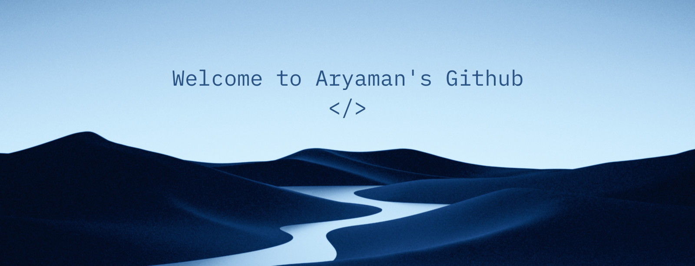
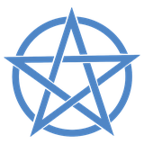
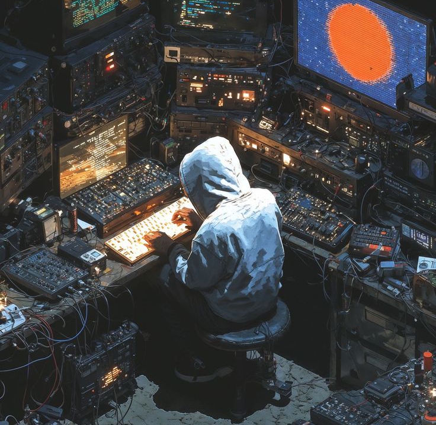

 

  

##  <i>Technologies</i>

 

 

 

  

##  <i>Statistics</i>

  

  

##  <i>About Me</i>

  Hello! My name is <strong>Aryaman Sharma</strong>, and I am a third-year
  <strong>B.Tech student in Artificial Intelligence & Machine Learning</strong>
  at Manipal University Jaipur.

  I'm passionate about building real-world AI projects,
  competitive programming, and learning new technologies.

  Currently I'm sharpening my skills in
  <strong>Python, C++, DSA, React and MongoDB</strong>,
  working on <strong>SignSense</strong> and an
  <strong>IPO recommender</strong>, and preparing for placements.

 

 

##  <i>Featured Projects</i>

| Project | What it does | Stack |
|---|---|---|
| **SignSense** | Real-time ASL gesture recognition with LLM post-processing into natural language (patent application published) | MediaPipe, Bi-LSTM, LLM |
| **IPO Recommender** | Recommends IPOs using retail application patterns, risk appetite and GMP trends | Python, ML |
| **SECOM Fault Detection** | Semiconductor wafer fault detection with sensor attribution | Python, ML |
| **TaskFlow** | Dark-themed, responsive task manager with Google sign-in, smart lists, categories and a calendar; every user's tasks are private | Node.js, Express, MongoDB, Google OAuth |

 

##  <i>Hobbies & Goals</i>

Reading — Collecting perspectives, not just pages.

Piano — Debugging life, one key at a time.

Cricket — Because not every problem needs a keyboard.

Goal: Build things people use · Land a product-based role · Turn ideas into impact

 

